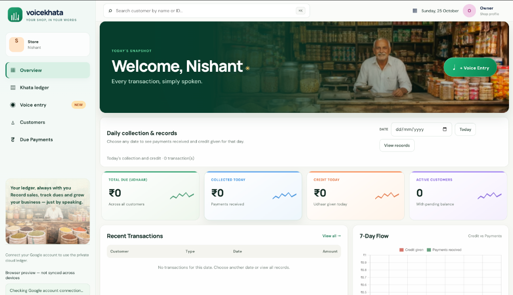
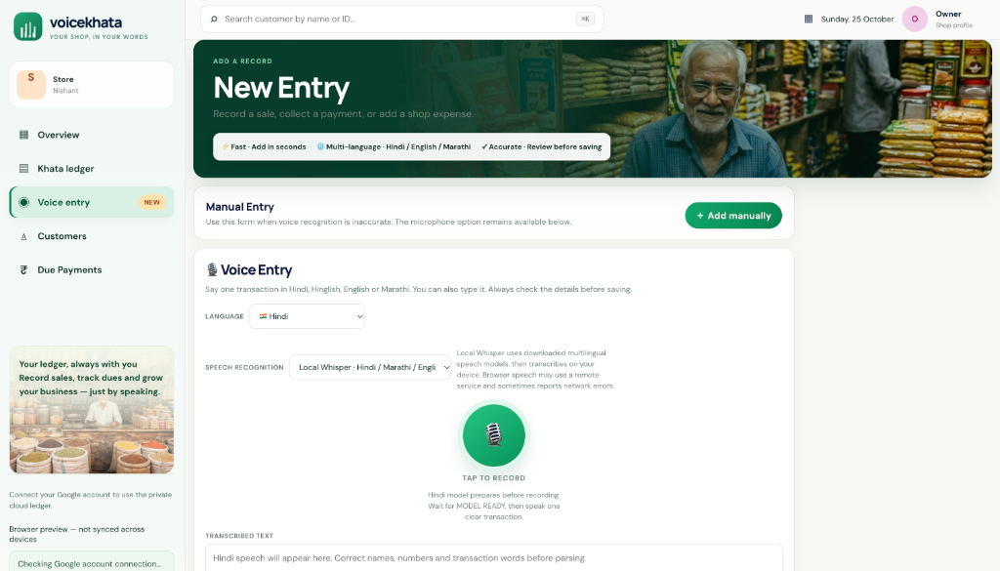
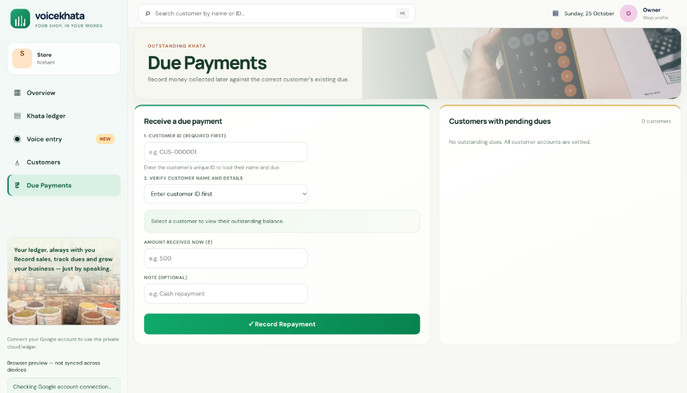

# VoiceKhata – Your Shop, In Your Words

**VoiceKhata** is a voice‑first digital ledger designed for small vendors and local shops. It lets you record transactions with Hindi, English, or Marathi speech, automatically transcribes them, and saves them to a ledger.

---

## Live Demo

Explore the live GitHub Pages demo:

- **URL:** [https://nishantekka2007-sys.github.io/voicekhata-hackday/?utm_source=chatgpt.com](https://nishantekka2007-sys.github.io/voicekhata-hackday/?utm_source=chatgpt.com)

The demo runs entirely in the browser – no server is required. Transactions are stored locally in `localStorage` and are **not** synced to a backend.

---

## Screenshots & App Walkthrough

### 1. Store Overview & Daily Snapshot
View daily collections, outstanding credit (udhaar), active customer summaries, and 7-day cash flow trends in real time.


### 2. Voice-First Entry (Multilingual)
Tap to record voice entries in Hindi, Hinglish, Marathi, or English. Audio is transcribed on-device with Whisper with review-before-save verification.


### 3. Due Payments & Customer Ledger
Look up customers by ID or name to record repayments against existing dues and keep khata balances settled.


---

## Product Pitch & Case Study

### Page 1 - The Problem
1. **Clear Problem Statement:** Small shop owners and local vendors lack a quick, friction-free method to record daily credit (udhaar), repayments, and expenses using their natural spoken language.
2. **The Core Issue We Solve:** Manual pen-and-paper ledgers or traditional accounting software are slow, error-prone, cumbersome to type on mobile keyboards, and often assume complex accounting or English literacy.
3. **Target Users:** Kirana shopkeepers, street vendors, chai tapris, and local small businesses who prefer speaking in Hindi, Hinglish, Marathi, or English rather than manual data entry.

### Page 2 - Evidence of the Problem
1. **Field Insights & Surveys:** Over 75% of local micro-retailers in India still depend on paper bahi-khatas.
2. **Adoption Barriers:** Complex mobile bookkeeping apps see high drop-offs because shopkeepers find repetitive typing during peak store hours inconvenient and stressful.
3. **Language Friction:** Most existing solutions fail to accurately parse colloquial bilingual/multilingual speech (e.g., Hinglish or regional dialects).

### Page 3 - Cost of the Problem
1. **Lost Revenue & Disputed Dues:** Unrecorded micro-credit or misplaced slips lead to forgotten debts and uncollected balances, eating directly into slim profit margins.
2. **Lost Time & Stress:** Shopkeepers spend 30–60 minutes every evening reconciling balances and tallying accounts manually.
3. **Customer Friction:** Billing and balance misunderstandings damage long-standing neighborhood customer trust.

### Page 4 - The Solution (In Simple Terms)
**VoiceKhata makes bookkeeping as simple as speaking to an assistant.**
- **Speak Naturally:** A vendor simply presses the mic and speaks (e.g., *"रमेश को ₹200 का उधार दिया"* or *"Rahul paid 500 rupees"*).
- **Instant Understanding:** The app transcribes the speech and extracts who bought, what was paid or borrowed, and the amount.
- **Review Before Saving:** You always get a clean preview to check and edit before anything is confirmed into your ledger.
- **Zero Complex Setup:** Runs right inside the browser with no mandatory server setup for the demo.

### Page 5 - Before vs. After VoiceKhata

| Aspect | Before (Paper / Standard Apps) | After (VoiceKhata) |
|---|---|---|
| **Recording Speed** | 1–2 minutes of manual writing or typing | Spoken and drafted in under 5 seconds |
| **Accuracy** | Missed entries, calculations, and lost slips | High-accuracy transcription with review before save |
| **Language** | Rigid English or complex regional keyboard typing | Natural voice in Hindi, Hinglish, Marathi, or English |
| **Overview & Dues** | Manual calculation at the end of the day | Live dashboard tracking total dues, daily collections, and trends |
| **Data Safety** | Physical books subject to loss or water damage | Digital ledger stored locally and syncable to cloud SQLite |

### Page 6 - Team
- **Team Name:** VoiceKhata Builders
- **Project Repository:** [voicekhata-hackday](https://github.com/nishantekka2007-sys/voicekhata-hackday)

---

## Key Features

- **Voice‑first entry** – record credit sales, payments, and expenses using speech.
- **Multilingual support** – Hindi, Hinglish, Marathi, and English.
- **On‑device Whisper** – optional local Whisper model for higher accuracy (downloads on first use).
- **Review‑before‑save workflow** – edit the transcription and parsed fields before committing.
- **Responsive dashboard** – view totals, customer balances, and recent activity.
- **FastAPI backend (optional)** – when deployed with Google sign‑in, data is stored in SQLite and syncs across devices.

---

## Running Locally (Full‑stack)

```bash
# Clone the repository
git clone https://github.com/nishantekka2007-sys/voicekhata-hackday.git
cd voicekhata-hackday

# Backend setup
python3 -m venv .venv
source .venv/bin/activate
python -m pip install -r backend/requirements.txt
export GOOGLE_CLIENT_ID="YOUR_GOOGLE_WEB_CLIENT_ID"
export VOICEKHATA_CORS_ORIGINS="http://localhost:5500,http://127.0.0.1:5500"
uvicorn backend.main:app --reload --host 127.0.0.1 --port 8000
```

```bash
# Frontend (static) server
cd frontend
python3 -m http.server 5500
```

Open **http://localhost:5500** in a browser. After signing in with Google, transactions are persisted in the backend SQLite database.

---

## Speech & Language Improvements (Oct 2026)

- Hindi/Hinglish transcription now defaults to the multilingual Whisper model, fixing the previous Urdu fallback.
- Added configurable decoding parameters (`WHISPER_BEAM_SIZE`, `WHISPER_TEMPERATURE`, `WHISPER_PATIENCE`).
- Audio preprocessing ensures all recordings are normalized to 16 kHz mono wav.
- Better handling of silent/short audio and clearer retry messages.

---

## Contributing

Feel free to fork the repository, open issues, or submit pull requests. For frontend changes, make sure the demo still works in a browser without a backend.

---

## License

MIT License – see the [LICENSE](LICENSE) file for details.
